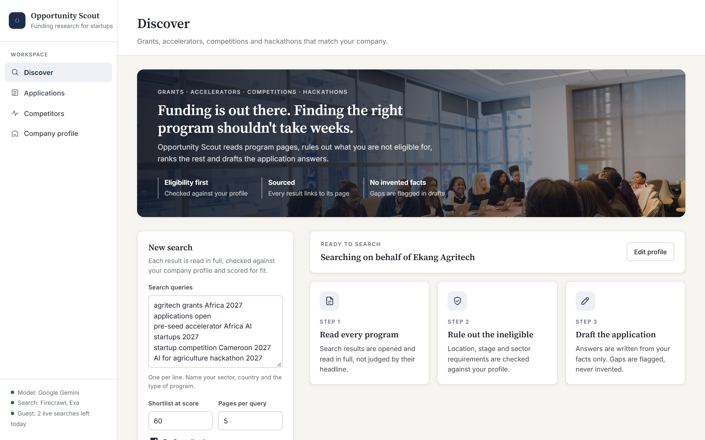
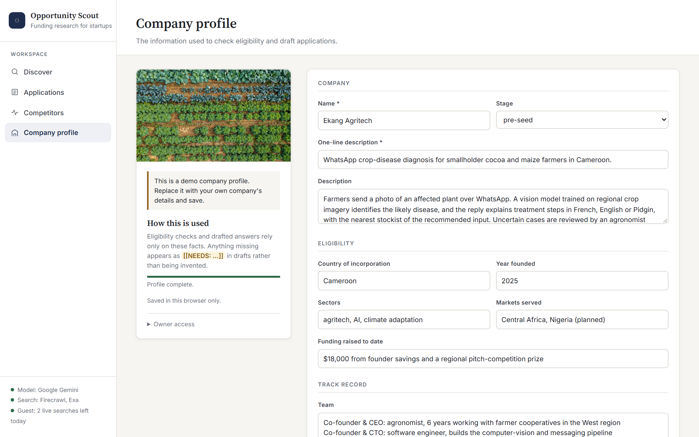
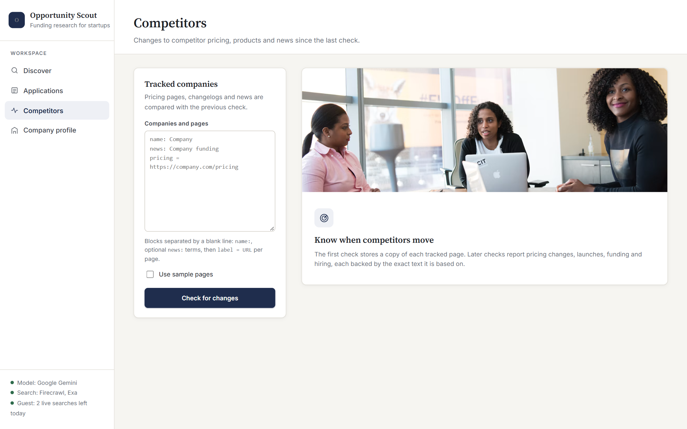
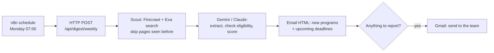
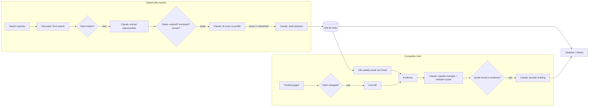

# Opportunity Scout

**An AI research agent that finds funding programs a startup can actually win, drafts the
applications, and emails the new ones every week.**

[](https://opportunity-scout-98lk.onrender.com)
[](https://github.com/Narcisse1/opportunity-scout/actions/workflows/ci.yml)




**Try it:** open the [live demo](https://opportunity-scout-98lk.onrender.com), no sign-up or key
needed. *Sample pages* mode is unlimited; live web searches are limited to a few per visitor
per day because each one spends real API credits. (Free hosting: the first load after a
quiet period can take about a minute.)

## What this project demonstrates

- **AI agent pipeline**: search → read → extract → check eligibility → score → draft, with every
  model call returning a validated, typed object (structured outputs, no free-text parsing).
- **Multi-provider LLM layer**: Google Gemini and Anthropic Claude behind one interface, with
  automatic model fallback when a quota or overload error hits.
- **Web data at scale**: Firecrawl and Exa combined, with fallbacks, de-duplication and
  skipping of login-only sites.
- **Workflow automation**: an n8n workflow turns the API into a weekly Gmail digest.
- **Safety and cost control**: prompt-injection hygiene, grounding checks on every competitor
  claim, guest rate limits, and zero LLM calls when nothing changed.
- **Production basics**: FastAPI with background jobs, SQLite state, Docker deployment on
  Render, 76 offline tests and CI on GitHub Actions, plus a labeled evaluation set.

## Built with

| Tool | Role in the project |
|---|---|
| **Google Gemini** / **Anthropic Claude** | The reasoning layer: extracts programs from pages, scores fit, checks eligibility, drafts answers, writes the competitor briefing. Switch with `LLM_PROVIDER`. |
| **[Firecrawl](https://firecrawl.dev)** | Web search plus scraping of each result into clean Markdown, so the model reads the whole program page rather than a snippet. |
| **[Exa](https://exa.ai)** | Neural search that finds program pages by meaning; also the fallback fetcher when a page can't be scraped. |
| **[n8n](https://n8n.io)** | Runs the weekly email: every Monday it calls the Scout API, then sends the digest through Gmail ([workflow](n8n/weekly-opportunities-email.json)). |
| **FastAPI** | Web API with background jobs, guest limits and the email digest endpoint. |
| **SQLite** | Memory between runs: pages already reviewed, tracked applications, competitor page snapshots. |
| **Docker + Render** | Deployment; **GitHub Actions** runs lint and tests on every push. |

## The problem

Early-stage founders, especially outside the big startup hubs, lose days every month
hunting for funding: grants, accelerators, hackathons and credit programs are scattered across
hundreds of sites, most turn out to be ineligible (wrong country, wrong stage, already closed),
and each application asks the same questions in a slightly different way. Deadlines live in
browser tabs and get missed.

## What Opportunity Scout does

An AI research analyst (Google Gemini or Anthropic Claude) that turns this into a 5-minute
weekly routine:

1. **Finds** programs on the live web (Firecrawl + Exa) and reads each page.
2. **Rules out** what you can't win: expired deadlines and excluded topics are dropped in
   code; location, stage and sector requirements are checked against your profile and
   explained as *eligibility blockers*.
3. **Ranks** what's left with a 0–100 fit score and the reasons behind it.
4. **Drafts** the application answers using only facts from your profile. Missing facts become
   `[[NEEDS: …]]` placeholders, never invented numbers.
5. **Tracks** your applications on a pipeline board (Saved → Applying → Submitted → Won/Lost)
   with notes, and exports every deadline to Google/Outlook/Apple Calendar with a 7-day
   reminder, or to CSV.
6. **Watches competitors**: diffs their pricing/changelog pages, reads the news, and writes a
   weekly briefing in which every claim quotes its source.
7. **Emails you every Monday** (n8n + Gmail): only programs that are new since last week and
   fit the profile, plus the deadlines coming up in your pipeline.

Use it from the **web app**, the **CLI**, by **email** (n8n), or on a **schedule** (GitHub
Actions). Reports also export to **Obsidian** and **Notion**.

## Screenshots

| Company profile (the facts used for eligibility and drafts) | Competitor tracking |
|---|---|
|  |  |

## Weekly email with n8n



1. Import [`n8n/weekly-opportunities-email.json`](n8n/weekly-opportunities-email.json) into n8n
   (the SDK source is next to it).
2. Replace `YOUR-SCOUT-HOST` with your deployment's address.
3. On **Run weekly scan**, create a *Header Auth* credential with name `X-Access-Token` and
   your `SCOUT_ACCESS_TOKEN` as the value. Edit the profile and queries in the JSON body to
   choose which opportunities you hear about.
4. On **Send weekly email**, connect Gmail and set the recipients, then publish.

The workflow first wakes the app (free hosting sleeps when idle) and waits a minute before
scanning. An email is sent when there are new programs or upcoming deadlines, and also when
the scan reports errors, so a broken week is never silent.

Because the scan remembers the pages it has already reviewed, each email contains only
programs that are new that week. `POST /api/digest/preview` renders the same email from
results already on screen (the *Preview this week's email* link in the app).

## Web app

```bash
uv run scout web          # http://127.0.0.1:8000
```

| Page | What you do there |
|---|---|
| **Discover** | Run a search; filter and sort scored results; open draft answers; add to Applications |
| **Applications** | Track programs by stage, keep notes, see the next deadline, export `.ics` / CSV |
| **Competitors** | Track competitor pages and news; read the sourced briefing |
| **Company profile** | The facts used for eligibility and drafting, with a completeness meter |

The app opens with **Ekang Agritech**, a fictional demo company (a pre-seed crop-disease
diagnosis startup in Cameroon), so it can be tried immediately. Replace it with your own
company on the profile page; the profile is stored in your browser only. Photography by
Christina @ wocintechchat.com and Bernd Dittrich via [Unsplash](https://unsplash.com).

**Sample pages** mode runs on bundled pages, so it works without web-search keys. Scans run as
background jobs (`POST /api/opportunities/scan`, `POST /api/intel/run`, then poll
`GET /api/jobs/{id}`); the pipeline lives at `/api/pipeline`, `/api/pipeline.ics` and
`/api/pipeline.csv`. Scraped text is always rendered as text, never as HTML.

**Deploy:** the `Dockerfile` serves the app on `$PORT` (Render, Railway, Fly.io). Set an LLM
key (`GEMINI_API_KEY` or `ANTHROPIC_API_KEY`), `FIRECRAWL_API_KEY` and/or `EXA_API_KEY`, and
`SCOUT_ACCESS_TOKEN`.

**Access model.** Anyone can open the app and use it as a guest: sample-page runs are
unlimited, and live web searches are capped (`SCOUT_GUEST_RUNS_PER_VISITOR`, default 3 a day;
`SCOUT_GUEST_RUNS_PER_DAY`, default 25 in total) and run smaller (3 queries × 3 pages), so
visitors can't drain the API budget. The owner enters `SCOUT_ACCESS_TOKEN` under *Company
profile → Owner access* to lift the limits; the weekly digest endpoint is owner-only. Set
`SCOUT_GUEST_ACCESS=off` to require the token for everything.



## Where the AI is

| Step | Model call | Output schema |
|---|---|---|
| Extract opportunities from a page | Claude, structured output | `ExtractionResult` |
| Score fit against the startup profile | Claude, structured output | `FitAssessment` |
| Draft application answers | Claude, structured output | `ApplicationDraft` |
| Classify competitor changes | Claude, structured output | `CompetitorAnalysis` |
| Write the briefing | Claude, structured output | `IntelDigest` |

All calls go through `scout/llm.py`, which returns validated Pydantic objects, so no step
parses free text. Two providers sit behind the same interface:

| `LLM_PROVIDER` | Key | Default model | How structured output works |
|---|---|---|---|
| `anthropic` | `ANTHROPIC_API_KEY` | `claude-opus-5-5` | `messages.parse()` + refusal fallbacks on supported models |
| `gemini` | `GEMINI_API_KEY` | best available Flash model (auto-discovered) | `response_schema` JSON mode; rotates to another model on quota or overload errors |

Override the model with `SCOUT_MODEL` (e.g. `claude-haiku-5-5` for low-cost runs). Cost
estimates use each model's own prices. Refusals and safety blocks raise the same typed errors
for both providers, so the pipelines don't depend on which one is active.

## Design decisions

- **Deterministic before probabilistic.** Expired deadlines, excluded keywords, already-known
  opportunities and unchanged pages are handled in code *before* any paid model call. A
  repeat run over the same pages makes **zero** LLM calls (covered by tests).
- **Grounding check against hallucinations.** Each competitor finding must carry a verbatim
  quote; findings whose quote is not literally present in the diff/news text are discarded
  and counted in the report.
- **Prompt-injection hygiene.** Scraped content is wrapped in `<untrusted_document>` /
  `<evidence>` tags and the system prompts say to treat it as data. The offline fixtures
  include an injection attempt.
- **Truthful drafts.** The drafting prompt may only use facts from `profile.yaml`; gaps become
  `[[NEEDS: ...]]` placeholders and a "gather before submitting" checklist.
- **Cache-friendly prompts.** System prompts (including the profile) are stable per run and
  marked with `cache_control`; per-call data such as today's date goes in the user turn.
- **Typed failure modes.** Refusals, truncation and missing output raise typed errors; a
  failed page is reported and *not* marked as processed, so it is retried next run.
  Server-side refusal fallbacks are enabled when the installed SDK supports them.
- **Cost visibility.** Every run reports token usage and estimated USD cost.
- **Incremental state.** SQLite stores processed URLs, known opportunities and page snapshots.

## Quick start

```bash
uv venv && uv pip install -e ".[dev]"
cp .env.example .env                 # add ANTHROPIC_API_KEY or GEMINI_API_KEY, plus FIRECRAWL/EXA keys
cp scout.example.yaml scout.yaml     # queries, competitors, output folder
cp profile.example.yaml profile.yaml # your startup's real facts

uv run pytest -q                     # offline test suite, no API keys needed

# Offline demo on bundled fictional pages (calls Claude, no scraping keys needed)
uv run scout opportunities --offline
uv run scout intel --offline --fixture-set week1   # baseline snapshot
uv run scout intel --offline --fixture-set week2   # detects pricing change, launch, funding news

# Live
uv run scout opportunities
uv run scout intel --profile profile.yaml
```

Notion: create a database with a `Name` title property, share it with your integration, set
`NOTION_TOKEN` and `NOTION_DATABASE_ID`, and set `output.notion: true`.

## Evaluation

`evals/fit_cases.yaml` holds human-labeled fit cases (strong / possible / poor / ineligible).

```bash
uv run python evals/run_fit_eval.py --repeat 3
```

It reports verdict accuracy, **ineligible recall** (the expensive mistake is telling a founder
to apply for something they can't win), consistency across repeats, and cost. Results are
saved to `evals/results/` so prompt changes can be compared. Add a case whenever a real
report gets a verdict you disagree with.

## Results

_Fill in after your own runs. Don't publish numbers you haven't measured._

- Fit eval: accuracy __ / ineligible recall __ over __ cases (model `claude-opus-5-5`)
- Typical weekly run: __ pages analysed, __ shortlisted, $__ per run
- Repeat run on unchanged sources: 0 LLM calls

## Project layout

```
scout/
  llm.py            Claude wrapper: structured outputs, fallbacks, typed errors, cost meter
  sources.py        Firecrawl, Exa, multi-source merge, offline fixtures
  http.py           retries with backoff and Retry-After
  store.py          SQLite state (seen URLs, opportunities, snapshots)
  opportunities.py  tracker pipeline (concurrent per page)
  intel.py          competitor monitor: diffing + grounding check
  publish.py        Obsidian Markdown + Notion
  prompts.py        system prompts
  cli.py            `scout` command
  web.py            FastAPI app: background jobs, pipeline API, exports
  exports.py        iCalendar (RFC 5545) and CSV exports of the pipeline
  emails.py         weekly email digest (HTML + text, scraped text escaped)
  static/index.html single-page UI (no build step)
n8n/                weekly email workflow (importable JSON + SDK source)
docs/images/        screenshots
tests/              offline tests (fake LLM, mocked HTTP)
evals/              labeled cases + eval runner
.github/workflows/  CI (ruff + pytest) and the scheduled run
```
