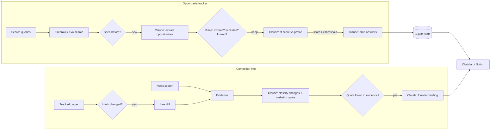

# Opportunity Scout

An autonomous research analyst built on **Claude** that does two jobs a startup founder
usually does by hand:

1. **Grant, accelerator & hackathon tracker**: searches the web (Firecrawl / Exa), extracts
   opportunities from each page, filters out expired or excluded ones, scores fit against your
   startup profile, and drafts tailored application answers for the shortlist.
2. **Competitor & market intelligence**: snapshots competitor pricing and changelog pages,
   detects what changed since last run, pulls recent news, and writes a sourced briefing.

Use it from the **web UI**, the **CLI**, or on a **schedule** (GitHub Actions). Reports land
in **Obsidian** (Markdown with YAML frontmatter) and optionally **Notion**.

## Web UI

```bash
uv run scout web          # http://127.0.0.1:8000
```

- **Startup profile** tab: your facts (saved in the browser). Drafts use only these.
- **Opportunities** tab: enter search queries, run a scan, get scored cards with reasons,
  eligibility blockers, deadlines, and copy-ready draft answers.
- **Competitor intel** tab: list competitors and their pricing/changelog URLs; get a
  briefing with verified, quoted evidence.
- **Offline demo** checkbox: runs on bundled sample pages (no scraping keys needed).

Scans run as background jobs (`POST /api/opportunities/scan`, `POST /api/intel/run`, poll
`GET /api/jobs/{id}`). Scraped text is always rendered as text, never as HTML. When hosting it
publicly, set `SCOUT_ACCESS_TOKEN` so only people with the token can spend your API credits.

**Deploy:** the included `Dockerfile` runs the UI on `$PORT`. It works on Render, Railway, or
Fly.io: set `ANTHROPIC_API_KEY`, `FIRECRAWL_API_KEY` and/or `EXA_API_KEY`, and `SCOUT_ACCESS_TOKEN`.



## Where the AI is

| Step | Model call | Output schema |
|---|---|---|
| Extract opportunities from a page | Claude, structured output | `ExtractionResult` |
| Score fit against the startup profile | Claude, structured output | `FitAssessment` |
| Draft application answers | Claude, structured output | `ApplicationDraft` |
| Classify competitor changes | Claude, structured output | `CompetitorAnalysis` |
| Write the briefing | Claude, structured output | `IntelDigest` |

All calls go through `scout/llm.py` using `client.messages.parse()` with Pydantic schemas,
so no step parses free text.

## Design decisions

- **Deterministic before probabilistic.** Expired deadlines, excluded keywords, already-known
  opportunities and unchanged pages are handled in code *before* any paid model call. A
  repeat run over the same pages makes **zero** LLM calls (covered by tests).
- **Grounding check against hallucinations.** Each competitor finding must carry a verbatim
  quote; findings whose quote is not literally present in the diff/news text are discarded
  and counted in the report.
- **Prompt-injection hygiene.** Scraped content is wrapped in `<untrusted_document>` /
  `<evidence>` tags and the system prompts say to treat it as data. The offline fixtures
  include an injection attempt.
- **Truthful drafts.** The drafting prompt may only use facts from `profile.yaml`; gaps become
  `[[NEEDS: ...]]` placeholders and a "gather before submitting" checklist.
- **Cache-friendly prompts.** System prompts (including the profile) are stable per run and
  marked with `cache_control`; per-call data such as today's date goes in the user turn.
- **Typed failure modes.** Refusals, truncation and missing output raise typed errors; a
  failed page is reported and *not* marked as processed, so it is retried next run.
  Server-side refusal fallbacks are enabled when the installed SDK supports them.
- **Cost visibility.** Every run reports token usage and estimated USD cost.
- **Incremental state.** SQLite stores processed URLs, known opportunities and page snapshots.

## Quick start

```bash
uv venv && uv pip install -e ".[dev]"
cp .env.example .env                 # add ANTHROPIC_API_KEY, FIRECRAWL_API_KEY and/or EXA_API_KEY
cp scout.example.yaml scout.yaml     # queries, competitors, output folder
cp profile.example.yaml profile.yaml # your startup's real facts

uv run pytest -q                     # offline test suite, no API keys needed

# Offline demo on bundled fictional pages (calls Claude, no scraping keys needed)
uv run scout opportunities --offline
uv run scout intel --offline --fixture-set week1   # baseline snapshot
uv run scout intel --offline --fixture-set week2   # detects pricing change, launch, funding news

# Live
uv run scout opportunities
uv run scout intel --profile profile.yaml
```

Notion: create a database with a `Name` title property, share it with your integration, set
`NOTION_TOKEN` and `NOTION_DATABASE_ID`, and set `output.notion: true`.

## Evaluation

`evals/fit_cases.yaml` holds human-labeled fit cases (strong / possible / poor / ineligible).

```bash
uv run python evals/run_fit_eval.py --repeat 3
```

It reports verdict accuracy, **ineligible recall** (the expensive mistake is telling a founder
to apply for something they can't win), consistency across repeats, and cost. Results are
saved to `evals/results/` so prompt changes can be compared. Add a case whenever a real
report gets a verdict you disagree with.

## Results

_Fill in after your own runs. Don't publish numbers you haven't measured._

- Fit eval: accuracy __ / ineligible recall __ over __ cases (model `claude-opus-5-5`)
- Typical weekly run: __ pages analysed, __ shortlisted, $__ per run
- Repeat run on unchanged sources: 0 LLM calls

## Project layout

```
scout/
  llm.py            Claude wrapper: structured outputs, fallbacks, typed errors, cost meter
  sources.py        Firecrawl, Exa, multi-source merge, offline fixtures
  http.py           retries with backoff and Retry-After
  store.py          SQLite state (seen URLs, opportunities, snapshots)
  opportunities.py  tracker pipeline (concurrent per page)
  intel.py          competitor monitor: diffing + grounding check
  publish.py        Obsidian Markdown + Notion
  prompts.py        system prompts
  cli.py            `scout` command
  web.py            FastAPI app: background jobs + JSON API
  static/index.html single-page UI (no build step)
tests/              offline tests (fake LLM, mocked HTTP)
evals/              labeled cases + eval runner
.github/workflows/  CI (ruff + pytest) and the scheduled run
```
