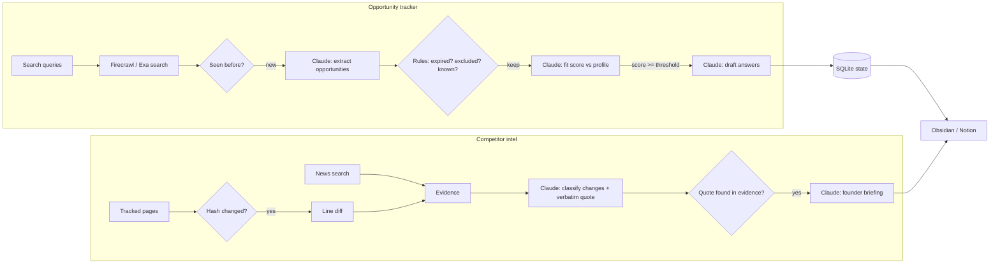

# Opportunity Scout

**Live demo:** https://opportunity-scout-98lk.onrender.com (free tier: the first load after
idle can take about a minute to wake up)

## The problem

Early-stage founders, especially outside the big startup hubs, lose days every month
hunting for funding: grants, accelerators, hackathons and credit programs are scattered across
hundreds of sites, most turn out to be ineligible (wrong country, wrong stage, already closed),
and each application asks the same questions in a slightly different way. Deadlines live in
browser tabs and get missed.

## What Opportunity Scout does

An AI research analyst (Google Gemini or Anthropic Claude) that turns this into a 5-minute
weekly routine:

1. **Finds** programs on the live web (Firecrawl + Exa) and reads each page.
2. **Rules out** what you can't win: expired deadlines and excluded topics are dropped in
   code; location, stage and sector requirements are checked against your profile and
   explained as *eligibility blockers*.
3. **Ranks** what's left with a 0–100 fit score and the reasons behind it.
4. **Drafts** the application answers using only facts from your profile. Missing facts become
   `[[NEEDS: …]]` placeholders, never invented numbers.
5. **Tracks** your applications on a pipeline board (Saved → Applying → Submitted → Won/Lost)
   with notes, and exports every deadline to Google/Outlook/Apple Calendar with a 7-day
   reminder, or to CSV.
6. **Watches competitors**: diffs their pricing/changelog pages, reads the news, and writes a
   weekly briefing in which every claim quotes its source.

Use it from the **web app**, the **CLI**, or on a **schedule** (GitHub Actions). Reports
also export to **Obsidian** and **Notion**.

## Web app

```bash
uv run scout web          # http://127.0.0.1:8000
```

| Page | What you do there |
|---|---|
| **Discover** | Run a scan; filter and sort scored results; open draft answers; add to pipeline |
| **Pipeline** | Move applications between stages, keep notes, see the next deadline, export `.ics` / CSV |
| **Competitors** | Track competitor pages and news; read the sourced weekly briefing |
| **Startup profile** | The facts used for eligibility and drafting, with a completeness meter |

**Demo mode** runs on bundled sample pages, so it works without web-search keys. Scans run as
background jobs (`POST /api/opportunities/scan`, `POST /api/intel/run`, then poll
`GET /api/jobs/{id}`); the pipeline lives at `/api/pipeline`, `/api/pipeline.ics` and
`/api/pipeline.csv`. Scraped text is always rendered as text, never as HTML.

**Deploy:** the `Dockerfile` serves the app on `$PORT` (Render, Railway, Fly.io). Set an LLM
key (`GEMINI_API_KEY` or `ANTHROPIC_API_KEY`), `FIRECRAWL_API_KEY` and/or `EXA_API_KEY`, and
`SCOUT_ACCESS_TOKEN`. The deployment is a single shared workspace (one team's pipeline),
protected by that token so only people you give it to can use your API credits.



## Where the AI is

| Step | Model call | Output schema |
|---|---|---|
| Extract opportunities from a page | Claude, structured output | `ExtractionResult` |
| Score fit against the startup profile | Claude, structured output | `FitAssessment` |
| Draft application answers | Claude, structured output | `ApplicationDraft` |
| Classify competitor changes | Claude, structured output | `CompetitorAnalysis` |
| Write the briefing | Claude, structured output | `IntelDigest` |

All calls go through `scout/llm.py`, which returns validated Pydantic objects, so no step
parses free text. Two providers sit behind the same interface:

| `LLM_PROVIDER` | Key | Default model | How structured output works |
|---|---|---|---|
| `anthropic` | `ANTHROPIC_API_KEY` | `claude-opus-5-5` | `messages.parse()` + refusal fallbacks on supported models |
| `gemini` | `GEMINI_API_KEY` | `gemini-flash-latest` | `response_schema` JSON mode, with retry/backoff for free-tier rate limits |

Override the model with `SCOUT_MODEL` (e.g. `claude-haiku-5-5` for low-cost runs). Cost
estimates use each model's own prices. Refusals and safety blocks raise the same typed errors
for both providers, so the pipelines don't depend on which one is active.

## Design decisions

- **Deterministic before probabilistic.** Expired deadlines, excluded keywords, already-known
  opportunities and unchanged pages are handled in code *before* any paid model call. A
  repeat run over the same pages makes **zero** LLM calls (covered by tests).
- **Grounding check against hallucinations.** Each competitor finding must carry a verbatim
  quote; findings whose quote is not literally present in the diff/news text are discarded
  and counted in the report.
- **Prompt-injection hygiene.** Scraped content is wrapped in `<untrusted_document>` /
  `<evidence>` tags and the system prompts say to treat it as data. The offline fixtures
  include an injection attempt.
- **Truthful drafts.** The drafting prompt may only use facts from `profile.yaml`; gaps become
  `[[NEEDS: ...]]` placeholders and a "gather before submitting" checklist.
- **Cache-friendly prompts.** System prompts (including the profile) are stable per run and
  marked with `cache_control`; per-call data such as today's date goes in the user turn.
- **Typed failure modes.** Refusals, truncation and missing output raise typed errors; a
  failed page is reported and *not* marked as processed, so it is retried next run.
  Server-side refusal fallbacks are enabled when the installed SDK supports them.
- **Cost visibility.** Every run reports token usage and estimated USD cost.
- **Incremental state.** SQLite stores processed URLs, known opportunities and page snapshots.

## Quick start

```bash
uv venv && uv pip install -e ".[dev]"
cp .env.example .env                 # add ANTHROPIC_API_KEY or GEMINI_API_KEY, plus FIRECRAWL/EXA keys
cp scout.example.yaml scout.yaml     # queries, competitors, output folder
cp profile.example.yaml profile.yaml # your startup's real facts

uv run pytest -q                     # offline test suite, no API keys needed

# Offline demo on bundled fictional pages (calls Claude, no scraping keys needed)
uv run scout opportunities --offline
uv run scout intel --offline --fixture-set week1   # baseline snapshot
uv run scout intel --offline --fixture-set week2   # detects pricing change, launch, funding news

# Live
uv run scout opportunities
uv run scout intel --profile profile.yaml
```

Notion: create a database with a `Name` title property, share it with your integration, set
`NOTION_TOKEN` and `NOTION_DATABASE_ID`, and set `output.notion: true`.

## Evaluation

`evals/fit_cases.yaml` holds human-labeled fit cases (strong / possible / poor / ineligible).

```bash
uv run python evals/run_fit_eval.py --repeat 3
```

It reports verdict accuracy, **ineligible recall** (the expensive mistake is telling a founder
to apply for something they can't win), consistency across repeats, and cost. Results are
saved to `evals/results/` so prompt changes can be compared. Add a case whenever a real
report gets a verdict you disagree with.

## Results

_Fill in after your own runs. Don't publish numbers you haven't measured._

- Fit eval: accuracy __ / ineligible recall __ over __ cases (model `claude-opus-5-5`)
- Typical weekly run: __ pages analysed, __ shortlisted, $__ per run
- Repeat run on unchanged sources: 0 LLM calls

## Project layout

```
scout/
  llm.py            Claude wrapper: structured outputs, fallbacks, typed errors, cost meter
  sources.py        Firecrawl, Exa, multi-source merge, offline fixtures
  http.py           retries with backoff and Retry-After
  store.py          SQLite state (seen URLs, opportunities, snapshots)
  opportunities.py  tracker pipeline (concurrent per page)
  intel.py          competitor monitor: diffing + grounding check
  publish.py        Obsidian Markdown + Notion
  prompts.py        system prompts
  cli.py            `scout` command
  web.py            FastAPI app: background jobs, pipeline API, exports
  exports.py        iCalendar (RFC 5545) and CSV exports of the pipeline
  static/index.html single-page UI (no build step)
tests/              offline tests (fake LLM, mocked HTTP)
evals/              labeled cases + eval runner
.github/workflows/  CI (ruff + pytest) and the scheduled run
```
